<p align="center">
  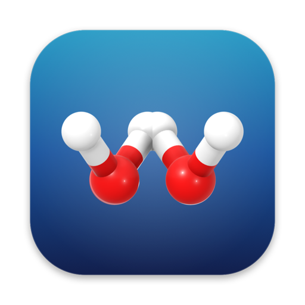
</p>

<h1 align="center">VibeView</h1>

VibeView is a native macOS molecular builder and viewer for computational chemistry: sketch a structure, set up a calculation, and look at the results (orbitals, vibrations, spectra) in one app.

Licensed under the MIT License (see `LICENSE`).

## Features

- **Sketching:** element tiles, a full periodic table, and a fragment library with thumbnails drawn from each fragment's own geometry.
  - Click empty space to place.
  - Click a hydrogen to substitute it.
  - Click a heavy atom to *replace it in place*: for example, an NH₂ fragment on a benzene carbon gives pyridine.
  - ⌥-click an atom to grow a new bonded atom.
- **Link tool:** bond any two atoms, even across fragments, as single, double or triple. ⌥-click a bond to delete it.
- **Gauge tool:** distance, angle and dihedral monitors that stay on screen. Type a new value and the smaller side of the structure moves.
- **Selection:** Pick (lasso) and Shift tools. Shift drags the selected atoms, and ⌥-drag rotates them. All edits are undoable.
- **Deleting atoms:** Delete/Backspace, ⌘⌫, the right-click menu, or `delete` in the console.
- **Name lookup:** search by name, CAS number, SMILES or CID through PubChem. You see candidates with a picture, formula and synonyms, then sketch with the result, insert it, or open it. SciFinder has no public API, so it isn't searched.
- **Command line:** a built-in console (⌘⇧C) with history, Tab completion, colored output, and `open`/`cd`/`ls` relative to the document's folder.
- **Calculations:** job setup for xtb, ORCA, Gaussian and Q-Chem.
  - An xtb settings sheet covers GFN level, optimization level, max cycles, solvent, charge/UHF, electronic temperature, threads and extra arguments, with a command preview.
  - Max-iteration fields for ORCA and Gaussian.
  - A live log viewer with search, follow mode, Reveal in Finder and Open in Console.
- **Reading files:** Gaussian, ORCA, Q-Chem, xtb, Molden, fchk, cube, XYZ, PDB, MOL, SDF and CML. Same-named companion files (`.molden.input`, `.hess`, `.fchk`…) load automatically.
- **Orbitals:** occupied and virtual color schemes, which you can change. Solid, transparent, wireframe or points display, and a grid-quality slider.
- **Analysis:** vibrations and spectra, point group detection and Symmetrize, hydrogen bonds and a clipping slab.
- **Sessions:** save and restore sessions (`.vibeview` JSON). Recent files are under File ▸ Open Recent.
- **Quick Look:** previews in Finder.

## Screenshots

### Orbitals

Orbitals load straight from ORCA/Gaussian output. Same-named Molden or fchk files are picked up automatically. Occupied orbitals are drawn red/blue and virtual orbitals green/yellow, as solid, transparent, wireframe or point surfaces.

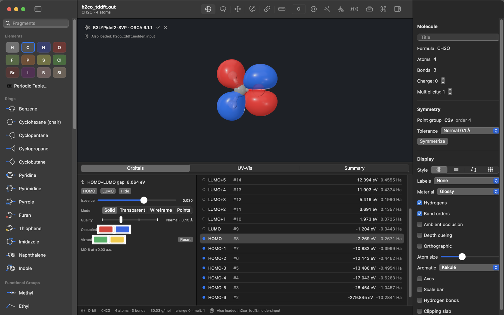

<p align="center">
  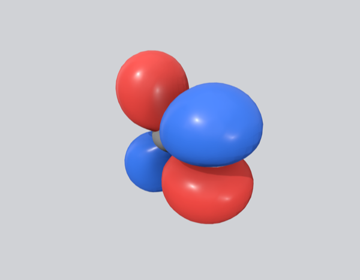
  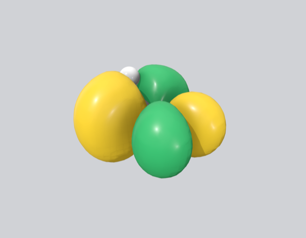
  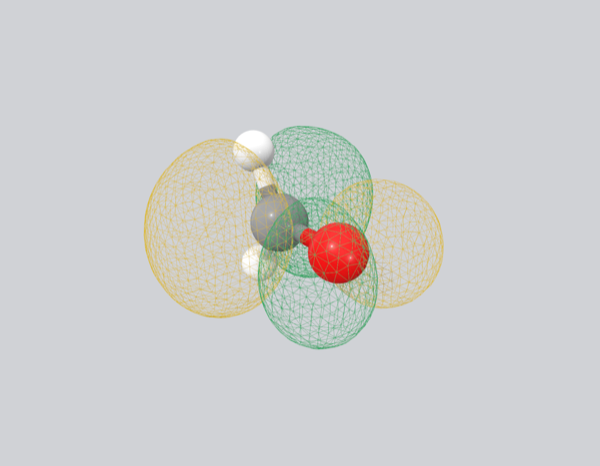
</p>
<p align="center"><sub>Formaldehyde, B3LYP/def2-SVP: HOMO (solid), LUMO (solid) and LUMO (wireframe)</sub></p>

### Vibrations and IR spectra

Pick a mode in the table, or click its peak, and the molecule vibrates. The animation runs on the GPU, so the view stays smooth while you rotate. Spectra use adjustable broadening and frequency scaling.

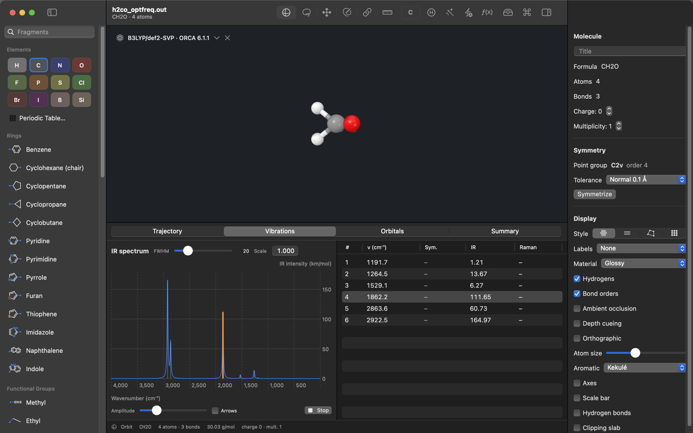

### UV-Vis from TD-DFT

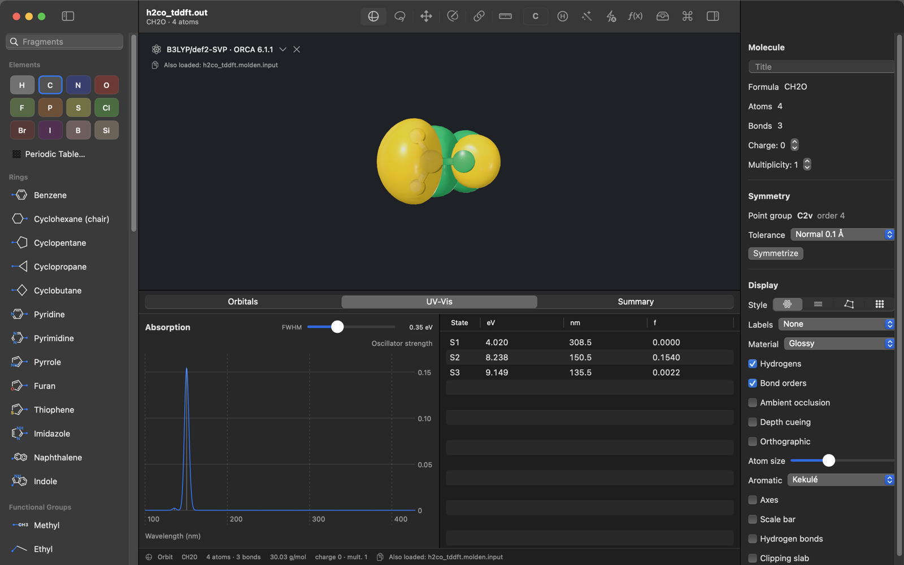

### Proteins and large structures

PDB files open with full connectivity and residue bond orders. Merged geometry keeps structures with thousands of atoms responsive. This is hemoglobin (4HHB, 4,779 atoms).

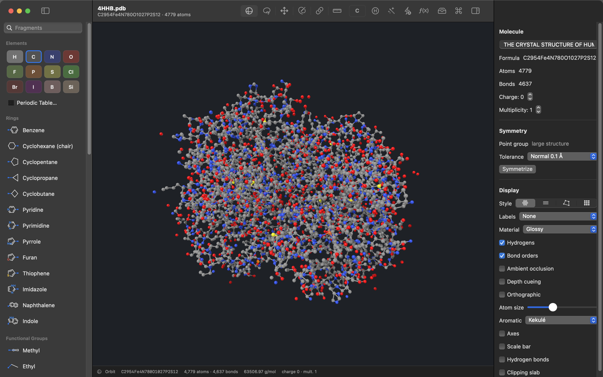

### Building, command line and xtb

<p align="center">
  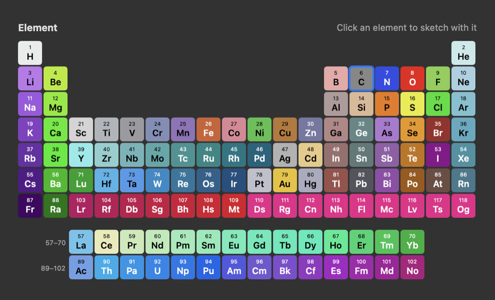
  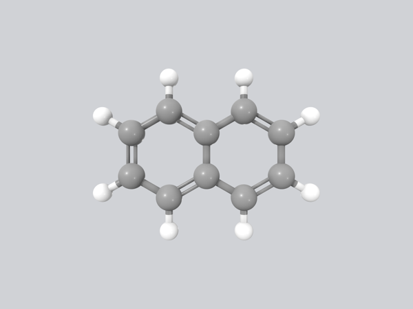
</p>

<p align="center">
  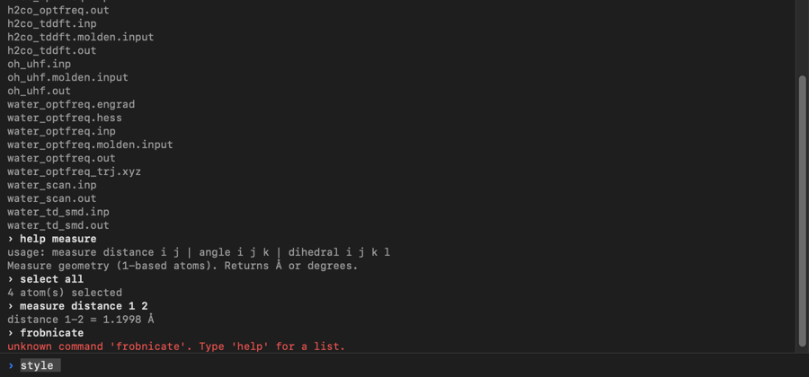
  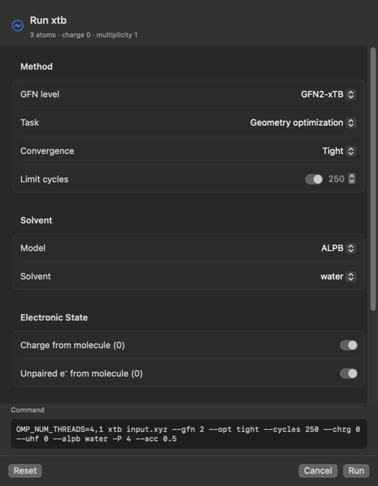
</p>
<p align="center"><sub>The full periodic table, aromatic rings as Kekulé structures, the built-in command line (⌘⇧C), and the xtb settings sheet with its command preview</sub></p>

## Quick install

Paste this into Terminal:

```sh
curl -fsSL https://raw.githubusercontent.com/ClevinLiju/VibeView/main/scripts/install.sh | bash
```

It downloads the latest release, installs VibeView in `/Applications`, and opens it. It also clears the download quarantine flag, so the first launch shows no Gatekeeper prompt. Requires an Apple Silicon Mac with macOS 14 or later.

Other options:

```sh
# install a specific version
curl -fsSL https://raw.githubusercontent.com/ClevinLiju/VibeView/main/scripts/install.sh | bash -s -- --version v0.3.0
# build from source instead (needs Xcode; also works on Intel Macs)
curl -fsSL https://raw.githubusercontent.com/ClevinLiju/VibeView/main/scripts/install.sh | bash -s -- --from-source
# uninstall
curl -fsSL https://raw.githubusercontent.com/ClevinLiju/VibeView/main/scripts/install.sh | bash -s -- --uninstall
```

To read the script before running it, download it first:
`curl -fsSLO https://raw.githubusercontent.com/ClevinLiju/VibeView/main/scripts/install.sh`, then `less install.sh`, then `bash install.sh`.

## Install from DMG

Download `VibeView-<version>.dmg`, open it and drag VibeView to Applications.

The app is ad-hoc signed (not notarized), so on first launch macOS will warn about it:

- Right-click (or Control-click) VibeView in Applications, choose Open, then Open; or
- System Settings ▸ Privacy & Security ▸ Open Anyway; or
- `xattr -dr com.apple.quarantine /Applications/VibeView.app`

See [docs/INSTALL.md](docs/INSTALL.md) for details.

## Build from source

Requires macOS 14+ and Xcode or the Command Line Tools with Swift 6.

```sh
swift build
swift run VibeView
swift run vibeview-check    # self-checks
scripts/make-app.sh         # dist/VibeView.app
scripts/make-dmg.sh         # dist/VibeView-<version>.dmg
```

## Optional external programs

VibeView can run calculations if the programs are installed; viewing and building work without them.

- xtb: `conda install -c conda-forge xtb` or `brew install xtb`
- ORCA (installed separately from the ORCA download site)
- Gaussian (commercial, installed separately)

## Developer environment variables

- `VIBEVIEW_SNAPSHOT_DIR`: write window snapshots to this directory
- `VIBEVIEW_SNAPSHOT_DELAY`: delay before taking snapshots
- `VIBEVIEW_GALLERY`: gallery mode
- `VIBEVIEW_SELFTEST`: run the built-in self-test
- `VIBEVIEW_DEBUG_IO`: debug output for file reading

The older `VIBEVIEW_*` names still work.

## Project layout

Internal modules keep their `Mol*` prefix:

- `Sources/MolCore`: chemistry model
- `Sources/MolIO`: file formats
- `Sources/MolCommand`: command-line language
- `Sources/MolBuild`: builder tools
- `Sources/MolRender`: SceneKit rendering
- `Sources/MolAnalysis`: orbitals, spectra, symmetry
- `Sources/MolCompute`: xtb runner, PubChem lookup
- `Sources/VibeViewApp`: the app (product `VibeView`)
- `Extensions/QuickLook`: Quick Look preview extension
- `scripts/`: packaging (app bundle, icon, DMG)


## About

VibeView is an independent, clean-room project, not affiliated with or derived from any commercial molecular viewer. Features were designed from public file-format documentation and general chemistry knowledge. The test fixtures under `Sources/MolChecks/TestData` are either hand-written or produced by small ORCA 6.1.1 runs.

The check suite runs with `swift run vibeview-check` (pass a filter to run part of it).
