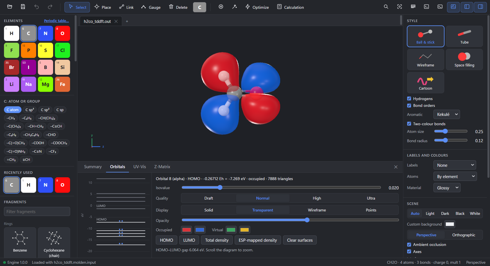
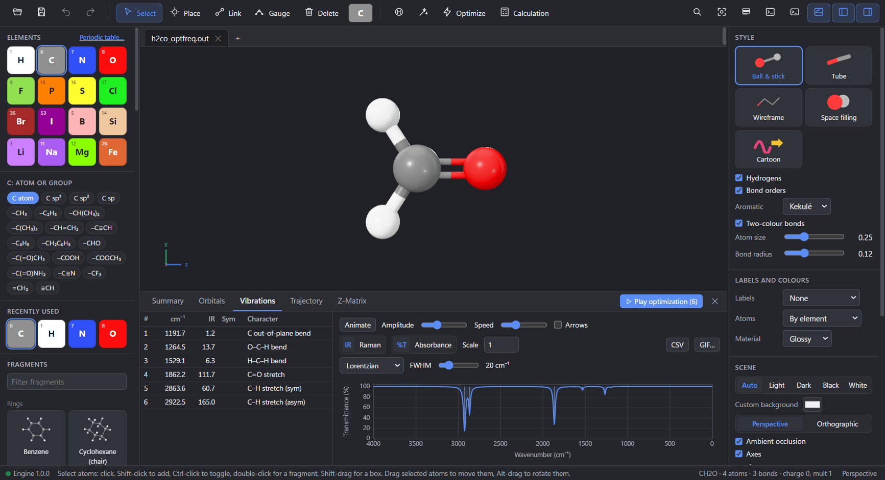
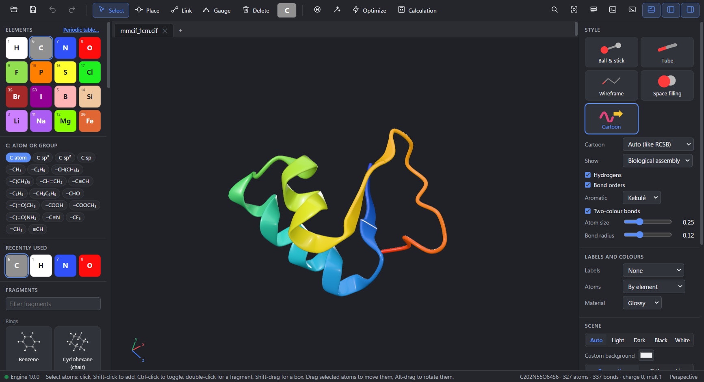
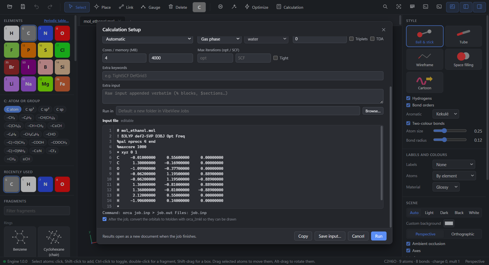

<p align="center">
  
</p>

<h1 align="center">VibeView for Windows</h1>

VibeView is a molecular builder and viewer for computational chemistry on Windows. You sketch a structure, set up a calculation and look at the results (orbitals, vibrations, spectra) in one app.

Licensed under the MIT License (see `LICENSE`).

## Features

- **Sketching:** element tiles, a periodic table, and functional groups for each element, sorted by hybridization. A fragment library, and building a molecule from a Z-matrix.
- **Editing:** link, gauge (distance, angle and dihedral monitors) and selection tools. All edits can be undone.
- **Name lookup:** search by name, CAS number, SMILES or CID through PubChem.
- **Calculations:** job setup for xtb, ORCA, Gaussian and Q-Chem.
  - Large lists of functionals and basis sets for each program.
  - An input preview you can edit; the edited text is what runs.
  - A live job log.
  - Gaussian checkpoints are turned into `.fchk` files with `formchk` automatically.
- **Reading files:** Gaussian, ORCA, Q-Chem, xtb, Molden, fchk, cube, XYZ, PDB, MOL, SDF and CML. Companion files with the same name (`.molden.input`, `.hess`, `.fchk`…) load automatically.
- **Display:**
  - Ball-and-stick, spacefill and Kekulé bonds.
  - Protein cartoon with helices and sheets.
  - Orbitals and density surfaces.
  - Each open document keeps its own camera.
- **Analysis:** vibrations and IR/Raman spectra, point-group detection, hydrogen bonds and a Z-matrix view.
- **Export:** XYZ, PDB, MOL/SDF, CML, Gaussian/ORCA/Q-Chem inputs and Molden. Images, and animated GIFs of optimisation trajectories and vibrations.
- **Command line:** a built-in console with history and Tab completion.

## Screenshots


*Orbitals: the HOMO of formaldehyde from an ORCA TD-DFT run, with the energy level diagram and surface controls.*


*Vibrations: normal modes from an ORCA frequency job, each with its character, and the broadened IR spectrum.*


*Proteins: crambin (PDB 1CRN) as a cartoon with helices and sheets.*


*Calculations: ORCA job setup for ethanol, with the input file you can edit before it runs.*

## Install

Requires 64-bit Windows 10 or 11.

1. Download `VibeView-Setup-<version>.exe` from the GitHub Releases page and run it. It installs per user, so no administrator rights are needed. The installer is not code-signed, so SmartScreen may warn you: choose More info ▸ Run anyway.
2. Start VibeView from the Start menu or the desktop shortcut.
3. To uninstall, go to Settings ▸ Apps ▸ Installed apps ▸ VibeView ▸ Uninstall.

The installer includes the Swift and Visual C++ runtimes. External programs (xtb, ORCA, Gaussian, Q-Chem) are installed separately; their locations can be set in Program Locations.

## Building from source

```powershell
scripts\windows\install-prereqs.ps1   # Swift toolchain, Visual Studio build tools, Node.js
scripts\windows\build.ps1             # engine, self-checks, front end, installer in windows\dist\
```

Front-end development commands (run inside `windows\`) are listed in [windows/README.md](windows/README.md).

## Checks

```powershell
swift run molscope-check            # chemistry self-checks
swift run vibeview-engine --selftest
```

## Layout

- `windows/`: the Electron + three.js desktop app.
- `Sources/VibeViewEngine`: the headless Swift engine (`vibeview-engine.exe`) the app talks to over JSON on stdio. [docs/WINDOWS_PROTOCOL.md](docs/WINDOWS_PROTOCOL.md) defines the protocol.
- `Sources/MolCore`, `MolIO`, `MolBuild`, `MolAnalysis`, `MolCompute`, `MolCommand`, `MolSIMD`: the chemistry libraries.
- `Sources/MolChecks`: self-checks (`molscope-check`).
- `scripts/windows/`: build, staging and prerequisite scripts.
- [docs/WINDOWS.md](docs/WINDOWS.md): architecture and build details.

## Releasing

1. Bump the number in `VERSION`.
2. Commit, then tag: `git tag vX.Y.Z && git push --tags`.
3. The GitHub Actions workflow (`.github/workflows/build.yml`) builds, runs the checks, builds the installer and attaches `VibeView-Setup-<version>.exe` to a new GitHub Release.
